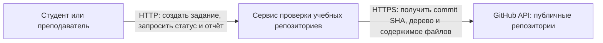
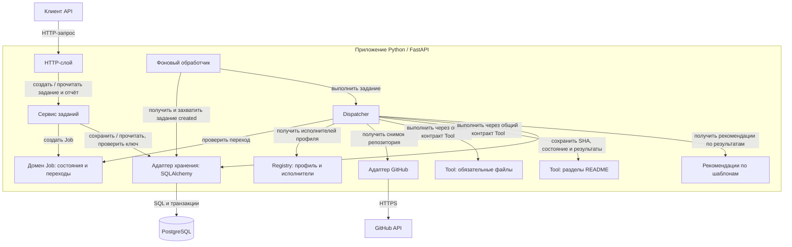
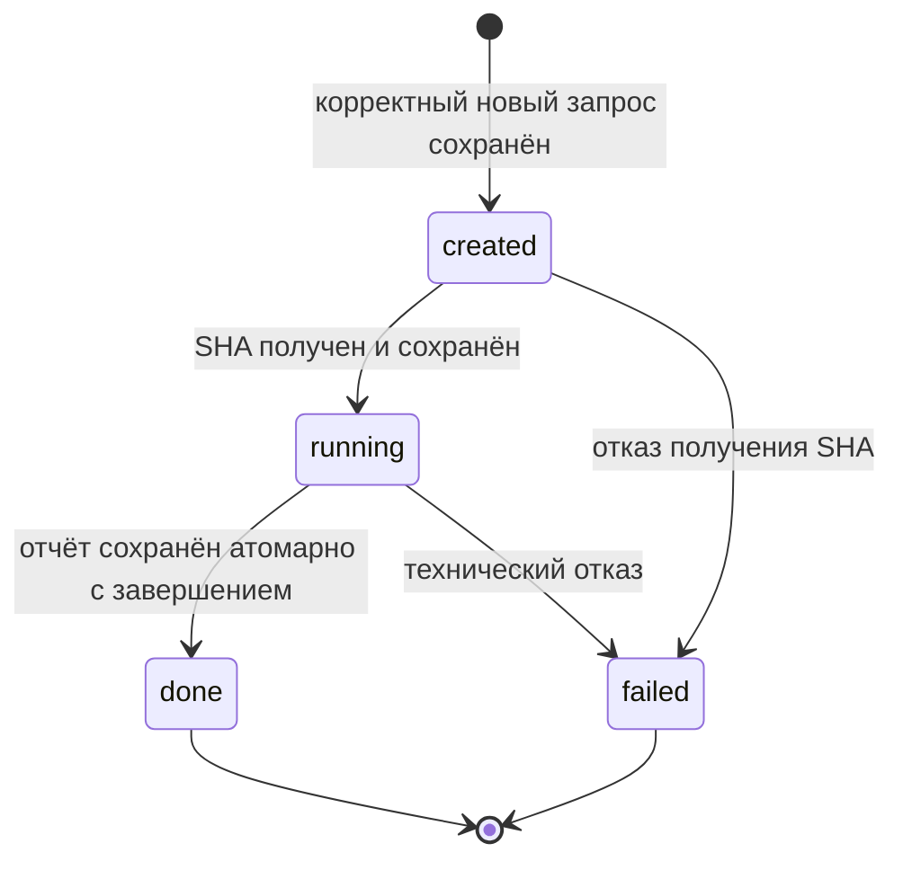

# Архитектура сервиса проверки учебных репозиториев

Документ описывает проектируемую систему. Основа — [README](../README.md) и [сценарии SC-01–SC-06](requirements.md). Состояния и четыре перехода сохранены из p1. Способ фонового выполнения, восстановление после перезапуска, вход Tool и формат ошибки перехода предложены в этом документе для согласования с авторами API и ADR; это ещё не утверждённые решения всей команды.

## 1. Контекст системы

**Смысл стрелок:** направленные вызовы во время работы; стрелка идёт от инициатора к получателю. Ответы возвращаются по тем же соединениям и отдельно не показаны. Это не диаграмма зависимостей кода.

Граница системы включает HTTP API, управление заданиями, проверки, адаптер GitHub и собственное хранилище. PostgreSQL относится к инфраструктуре нашей системы и показан на схеме компонентов. Проверяемый репозиторий принадлежит внешней системе GitHub; его код не выполняется.

Пользователь получает сохранённые результаты через наш API. Только адаптер GitHub обращается к внешнему API. Запрос уже сохранённого статуса или отчёта не вызывает повторный анализ GitHub (SC-02).

В первом семестре компонент рекомендаций использует шаблоны. Внешняя LLM в текущем контексте не участвует; во втором семестре её подключение потребует обновления схемы контекста.

## 2. Компоненты и взаимодействие

**Смысл стрелок:** вызовы компонентов во время выполнения, а не импорты или зависимости исходного кода. Ответы и возвращаемые значения не показаны. Вызовы конкретных Tool на схеме показывают возможных получателей; Dispatcher обращается к ним через единый контракт и получает реализации из Registry.

**Предложение для ADR:** один процесс приложения и отдельный сервис PostgreSQL. Фоновый обработчик берёт сохранённые задания из БД; отдельный брокер сообщений не вводится. HTTP-слой не ожидает окончания анализа. Механизм захвата задания должен исключать одновременное выполнение одного Job несколькими обработчиками. Детали транзакций и восстановления после сбоя согласуются отдельно.

### Ответственность и скрываемые детали

| Компонент | Ответственность | Что скрывает от соседей |
|---|---|---|
| HTTP-слой | Принимает запросы, проверяет форму данных, преобразует результаты и ошибки в HTTP-ответы | FastAPI, маршрутизацию, сериализацию и HTTP-коды |
| Сервис заданий | Создаёт Job с учётом идемпотентности, возвращает сохранённые статусы и отчёты | Порядок шагов прикладных операций и обработку повторов |
| Фоновый обработчик | Выбирает сохранённые задания и передаёт их Dispatcher | Опрос очереди заданий в БД, расписание запуска и управление выполнением |
| Домен Job | Хранит правила состояний и отклоняет недопустимые переходы | Внутреннее представление состояний и проверку инвариантов; не зависит от HTTP и БД |
| Dispatcher | Координирует получение снимка, исполнение проверок и сохранение результата | Порядок обработки и объединение результатов; не содержит правил конкретных проверок |
| Registry | Сопоставляет профиль с исполнителями общего контракта | Состав профиля и способ регистрации конкретных Tool |
| Tool обязательных файлов | Проверяет README.md и CONTRIBUTING.md в снимке репозитория | Алгоритм проверки путей и подготовки пояснений |
| Tool разделов README | Проверяет обязательные заголовки в README зафиксированного коммита | Разбор Markdown и сопоставление заголовков |
| Адаптер GitHub | Получает SHA и данные репозитория, преобразует отказы внешнего API в ошибки приложения | HTTP-клиент, заголовки GitHub, форматы ответов, timeout и ограниченный retry |
| Адаптер хранения | Реализует операции хранения и атомарные изменения состояния | SQLAlchemy, SQL, таблицы, блокировки и границы транзакций |
| PostgreSQL | Долговременно хранит задания, ключи и результаты | Физическое хранение и исполнение транзакций |
| Компонент рекомендаций | Формирует отдельные рекомендации по результатам и README | Шаблоны первого семестра, а в будущем — реализацию через LLM |

### Границы зависимостей кода

Домен Job и правила проверок не зависят от FastAPI, SQLAlchemy и HTTP-клиента. Прикладные компоненты используют контракты хранения, источника данных и Tool; конкретные адаптеры подключаются при сборке приложения. Registry регистрирует реализации, поэтому добавление нового Tool не требует изменения Dispatcher.

**Предложение для контракта Tool:** Dispatcher передаёт исполнителям подготовленный снимок репозитория и настройки профиля. Tool не обращаются напрямую к GitHub и БД. Точный состав входных данных и ошибок определяет автор блока 3; архитектура не подменяет этот контракт.

Схемы описывают целевую систему первого семестра. На практике 3 ядро Job, Dispatcher, Registry и Tool реализуется без HTTP и БД; адаптеры окружения подключаются позже. Контракт хранения позволяет временно использовать реализацию в памяти, сохраняя границы компонентов.

## 3. Обработка задания

1. HTTP-слой принимает запрос. При некорректных входных данных задание не создаётся и GitHub не вызывается (SC-05).
2. Сервис заданий атомарно сохраняет новое задание `created` и связь с ключом идемпотентности. При идентичном повторе возвращается прежний id; конфликт параметров не меняет существующий Job (SC-04).
3. Фоновый обработчик передаёт задание Dispatcher. Пока определяется SHA основной ветки, состояние остаётся `created`, как предусмотрено SC-03. Сам захват задания обработчиком не является состоянием Job.
4. При отказе получения SHA задание становится `failed`. При успехе SHA сохраняется вместе с переходом в `running`.
5. Все дальнейшие запросы данных и проверки относятся к этому SHA. Registry предоставляет два исполнителя профиля `basic`; они возвращают результаты с полями `check_name`, `status`, `details`.
6. Отчёт и переход в `done` сохраняются одной транзакцией. Отсутствующий файл или раздел означает нарушение требования в отчёте, а не `failed` (SC-06).
7. При техническом отказе сохраняются `failed` и причина ошибки; завершённый отчёт проверок не публикуется. Промежуточные результаты не выдаются как полный отчёт.
8. Рекомендации сохраняются отдельно от формальных результатов. Ошибка рекомендаций не отменяет готовый отчёт и не переводит `done` в `failed`.
9. Статус и сохранённый результат читаются из БД; повторный запрос не запускает анализ.

Порядок шага с рекомендациями — предложение: формальная проверка завершается независимо, рекомендации могут быть сформированы позднее. Политику их доступности нужно согласовать в API; состояние Job описывает именно формальную проверку.

## 4. Состояния Job

**Смысл стрелок:** допустимые изменения состояния одного Job. Псевдосостояние `[*]` обозначает создание и окончание жизненного цикла, а не отдельное хранимое состояние или удаление записи. Чтение статуса, повтор HTTP-запроса и повторный опрос обработчиком не являются переходами.

| Состояние | Значение и инварианты |
|---|---|
| `created` | Job сохранён. SHA ещё не зафиксирован; получение SHA может уже выполняться. Завершённого отчёта нет. |
| `running` | SHA сохранён; выполняются проверки только этой версии. Завершённого отчёта нет. |
| `done` | Полный отчёт сохранён. Он может содержать нарушения. Формальные результаты неизменны. |
| `failed` | Сохранена машиночитаемая причина технического отказа. Завершённого отчёта нет. Новая попытка требует нового Job и нового ключа. |

В требованиях p1 `created` назван состоянием до начала обработки, но SC-03 оставляет его до получения SHA. Здесь «обработка» в определении состояния означает запуск проверок: подготовительный вызов за SHA выполняется ещё в `created`. Новое состояние для подготовки не вводится; это уточнение терминов выносится на review.

### Запрещённые переходы и реакция системы

Разрешены только четыре перехода между хранимыми состояниями, показанные на диаграмме. Все остальные изменения отклоняются, в частности:

Полная матрица переходов: строка — текущее состояние, столбец — запрошенное. «Отказ» означает явную ошибку без изменения Job.

| Из / в | `created` | `running` | `done` | `failed` |
|---|---|---|---|---|
| `created` | Отказ | Разрешён после фиксации SHA | Отказ | Разрешён при отказе получения SHA |
| `running` | Отказ | Отказ | Разрешён вместе с сохранением отчёта | Разрешён при техническом отказе |
| `done` | Отказ | Отказ | Отказ | Отказ |
| `failed` | Отказ | Отказ | Отказ | Отказ |

Причины запретов:

| Попытка | Причина отказа |
|---|---|
| `created` в `done` | Нет этапа проверок зафиксированной версии |
| `running` в `created` | Возврат к исходному состоянию не предусмотрен |
| Переход из `done` в `created`, `running` или `failed` | Формальная проверка уже завершена |
| Переход из `failed` в `created`, `running` или `done` | Перезапуск существующего Job не предусмотрен |
| Повторное присвоение текущего состояния как команда перехода | Такая команда отсутствует в списке переходов; это не идемпотентный повтор создания Job |

**Предложение для согласования:** домен возвращает ошибку `invalid_job_transition` с текущим и запрошенным состояниями. Состояние, SHA, ошибка и формальный отчёт остаются неизменными; ошибка фиксируется в журнале с correlation ID. При конкурентном обновлении проверка ожидаемого состояния и изменение выполняются атомарно, проигравшее обновление не перезаписывает победившее.

Например, попытка перевести `done` в `running` отклоняется с `code = invalid_job_transition`, `details.current_state = done`, `details.requested_state = running`. Правило проверяется самим Job; журналирование выполняет вызывающий прикладной слой, чтобы домен не зависел от инфраструктуры.

Если прикладная операция, доступная через HTTP, требует запрещённого перехода, предлагается вернуть `409` в общем формате ошибок API. Это не вводит публичный маршрут произвольного изменения состояния: его в сценариях p1 нет. Точное тело ошибки и наличие HTTP-операций определяются в OpenAPI. Ошибка внутреннего обработчика отклоняется на уровне приложения и диагностируется в логах; она не перезаписывает сохранённую причину `failed` или готовый отчёт `done`.

### Предложение: восстановление после перезапуска

Для первой версии предлагается один экземпляр приложения с одним фоновым обработчиком. Новый процесс начинает восстановление только после остановки прежнего: параллельный запуск нескольких экземпляров пока не поддерживается и должен быть явно ограничен в ADR.

- Сохранённые `created` остаются в очереди; временный захват остановленного обработчика освобождается, получение SHA можно повторить. Проверки ещё не начинались, внешние обращения только читают данные GitHub.
- Оставшиеся `running` переводятся в `failed` с причиной `interrupted` до запуска нового обработчика. Используется уже разрешённый переход `running → failed`; повтор проверки требует нового задания с новым ключом.
- `done` и `failed` не изменяются. Сохранённые ключи идемпотентности продолжают возвращать прежние задания.
- Старый ответ не может перезаписать терминальное состояние: перед фиксацией результата проверяется ожидаемое состояние и владение заданием. Обновление состояния и публикация отчёта выполняются атомарно.

Это предложение закрывает зависание Job в `running` без добавления новых состояний. Оно требует согласования авторами ADR и проверки колодой. При переходе к нескольким экземплярам приложения понадобится отдельное решение о владении заданиями и восстановлении; простая массовая смена `running` на `failed` для такой конфигурации не подходит.

## 5. Что согласовать с другими блоками

| Вопрос | Предложение / существующее ограничение | Где закрепить |
|---|---|---|
| Фоновое выполнение | Один процесс приложения, очередь заданий в PostgreSQL, атомарный захват | ADR автора блока 3 |
| Подготовка SHA | До фиксации SHA Job остаётся `created`; после фиксации становится `running` | Сценарии и OpenAPI, совместная проверка блоков 1–2 |
| Вход Tool | Подготовленный снимок зафиксированного коммита; без самостоятельных сетевых вызовов | Контракт Tool |
| Недопустимый переход | `invalid_job_transition`, неизменность Job; при применимой HTTP-операции — `409` | Контракт домена и OpenAPI |
| Отмена и перезапуск | В состояниях p1 нет отмены; существующий `failed` не перезапускается | Явно определить ограничения API и при необходимости обоснование в ADR |
| Восстановление после перезапуска | Предложение выше: один экземпляр; `created` остаются в очереди, оставшиеся `running` становятся `failed` с `interrupted` | ADR / API и К9 проверки колодой |
| Рекомендации | Отдельный результат, который не изменяет терминальное состояние формальной проверки | API и при необходимости ADR |

Этот список отражает оставшиеся решения команды, а не готовую проверку К1–К10. Перед итоговой сдачей архитектура должна быть согласована с OpenAPI, контрактом Tool и ADR, а вопросы — закрыты конкретными решениями.

## 6. Источники

- [Задание p2, пункты 1–2](https://github.com/AIProgramIngeneering2026/Zadania/blob/main/tasks/p2.md).
- [Сценарии и жизненный цикл проекта](requirements.md).
- [Границы проекта и место подключения LLM](../README.md).
