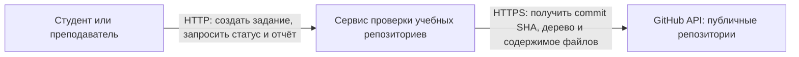
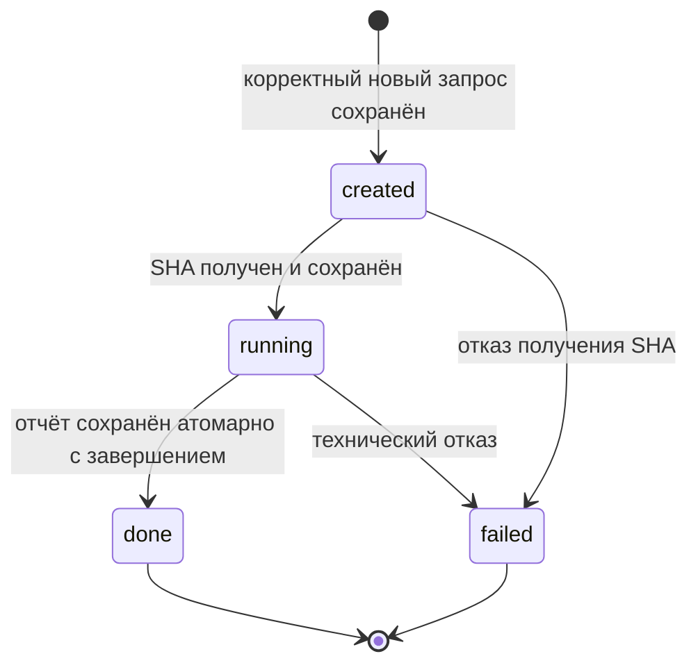

# Архитектура сервиса проверки учебных репозиториев

Схемы и состояния Job основаны на [описании проекта](../README.md) и [сценариях SC-01–SC-06](requirements.md).

## 1. Контекст системы

**Смысл стрелок:** направленные вызовы во время работы; стрелка идёт от инициатора к получателю. Ответы возвращаются по тем же соединениям и отдельно не показаны. Это не диаграмма зависимостей кода.

Граница системы включает HTTP API, управление заданиями, проверки, адаптер GitHub и собственное хранилище. PostgreSQL относится к инфраструктуре нашей системы и показан на схеме компонентов. Проверяемый репозиторий принадлежит внешней системе GitHub; его код не выполняется.

Пользователь получает сохранённые результаты через наш API. Только адаптер GitHub обращается к внешнему API. Запрос уже сохранённого статуса или отчёта не вызывает повторный анализ GitHub (SC-02).

В первом семестре рекомендации формируются локально по шаблонам; внешней зависимости от LLM пока нет.

## 2. Компоненты и взаимодействие

**Смысл стрелок:** вызовы компонентов во время выполнения, а не импорты или зависимости исходного кода. Ответы и возвращаемые значения не показаны. Вызовы конкретных Tool на схеме показывают возможных получателей; Dispatcher обращается к ним через единый контракт и получает реализации из Registry.

Формальный отчёт и переход Job в `done` сохраняются атомарно до формирования рекомендаций. Рекомендации сохраняются отдельно. Если компонент рекомендаций завершился ошибкой, готовый отчёт остаётся доступным, состояние Job сохраняется как `done`; переход в `failed` не выполняется.

### Ответственность и скрываемые детали

| Компонент | Ответственность | Что скрывает от соседей |
|---|---|---|
| HTTP-слой | Принимает запросы, проверяет форму данных, преобразует результаты и ошибки в HTTP-ответы | FastAPI, маршрутизацию, сериализацию и HTTP-коды |
| Сервис заданий | Создаёт Job с учётом идемпотентности, возвращает сохранённые статусы и отчёты | Порядок шагов прикладных операций и обработку повторов |
| Фоновый обработчик | Выбирает сохранённые задания и передаёт их Dispatcher | Механизм выбора заданий и управление фоновым выполнением |
| Домен Job | Хранит правила состояний и отклоняет недопустимые переходы | Внутреннее представление состояний и проверку инвариантов; не зависит от HTTP и БД |
| Dispatcher | Координирует получение снимка, исполнение проверок и сохранение результата | Порядок обработки и объединение результатов; не содержит правил конкретных проверок |
| Registry | Сопоставляет профиль с исполнителями общего контракта | Состав профиля и способ регистрации конкретных Tool |
| Tool обязательных файлов | Проверяет README.md и CONTRIBUTING.md в снимке репозитория | Алгоритм проверки путей и подготовки пояснений |
| Tool разделов README | Проверяет обязательные заголовки в README зафиксированного коммита | Разбор Markdown и сопоставление заголовков |
| Адаптер GitHub | Получает SHA и данные репозитория, преобразует отказы внешнего API в ошибки приложения | HTTP-клиент, заголовки GitHub, форматы ответов, timeout и ограниченный retry |
| Адаптер хранения | Реализует операции хранения и атомарные изменения состояния | SQLAlchemy, SQL, таблицы, блокировки и границы транзакций |
| PostgreSQL | Долговременно хранит задания, ключи и результаты | Физическое хранение и исполнение транзакций |
| Компонент рекомендаций | Формирует отдельные рекомендации по результатам и README | Шаблоны первого семестра, а в будущем — реализацию через LLM |

### Границы зависимостей кода

Домен Job и правила проверок не зависят от FastAPI, SQLAlchemy и HTTP-клиента. Прикладные компоненты используют контракты хранения, источника данных и Tool; конкретные адаптеры подключаются при сборке приложения. Registry регистрирует реализации, поэтому добавление нового Tool не требует изменения Dispatcher.

## 3. Состояния Job

**Смысл стрелок:** допустимые изменения состояния одного Job. Псевдосостояние `[*]` обозначает создание и окончание жизненного цикла, а не отдельное хранимое состояние или удаление записи. Чтение статуса, повтор HTTP-запроса и повторный опрос обработчиком не являются переходами.

| Состояние | Значение и инварианты |
|---|---|
| `created` | Job сохранён. SHA ещё не зафиксирован; получение SHA может уже выполняться. Завершённого отчёта нет. |
| `running` | SHA сохранён; выполняются проверки только этой версии. Завершённого отчёта нет. |
| `done` | Полный отчёт сохранён. Он может содержать нарушения. Формальные результаты неизменны. |
| `failed` | Сохранена машиночитаемая причина технического отказа. Завершённого отчёта нет. Новая попытка требует нового Job и нового ключа. |

Согласно SC-03, получение SHA выполняется ещё в `created`. Состояние `running` означает начало проверок уже зафиксированной версии репозитория.

### Запрещённые переходы и реакция системы

Разрешены только четыре перехода между хранимыми состояниями, показанные на диаграмме. Все остальные изменения отклоняются.

Полная матрица переходов: строка — текущее состояние, столбец — запрошенное. «Отказ» означает явную ошибку без изменения Job.

| Из / в | `created` | `running` | `done` | `failed` |
|---|---|---|---|---|
| `created` | Отказ | Разрешён после фиксации SHA | Отказ | Разрешён при отказе получения SHA |
| `running` | Отказ | Отказ | Разрешён вместе с сохранением отчёта | Разрешён при техническом отказе |
| `done` | Отказ | Отказ | Отказ | Отказ |
| `failed` | Отказ | Отказ | Отказ | Отказ |

Причины запретов:

| Попытка | Причина отказа |
|---|---|
| `created` в `done` | Нет этапа проверок зафиксированной версии |
| `running` в `created` | Возврат к исходному состоянию не предусмотрен |
| Переход из `done` в `created`, `running` или `failed` | Формальная проверка уже завершена |
| Переход из `failed` в `created`, `running` или `done` | Перезапуск существующего Job не предусмотрен |
| Повторное присвоение текущего состояния как команда перехода | Такая команда отсутствует в списке переходов; это не идемпотентный повтор создания Job |

При попытке запрещённого перехода сам Job возвращает явную ошибку `invalid_job_transition` с текущим и запрошенным состояниями. Состояние, SHA, сохранённая причина технического отказа и формальный отчёт остаются неизменными.

Например, попытка перевести `done` в `running` отклоняется с `code = invalid_job_transition`, `details.current_state = done`, `details.requested_state = running`. Это описание ошибки домена; её преобразование в HTTP-ответ определяется контрактом API. Публичная операция произвольного изменения состояния этим документом не вводится.

## 4. Источники

- [Задание p2, пункты 1–2](https://github.com/AIProgramIngeneering2026/Zadania/blob/main/tasks/p2.md).
- [Сценарии и жизненный цикл проекта](requirements.md).
- [Границы проекта и место подключения LLM](../README.md).
